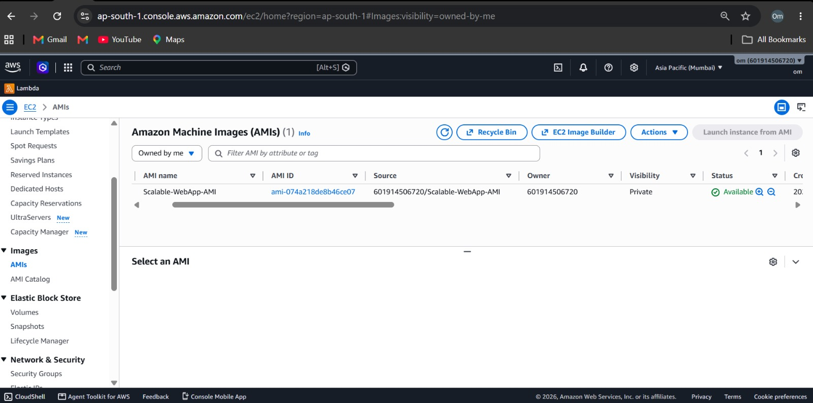
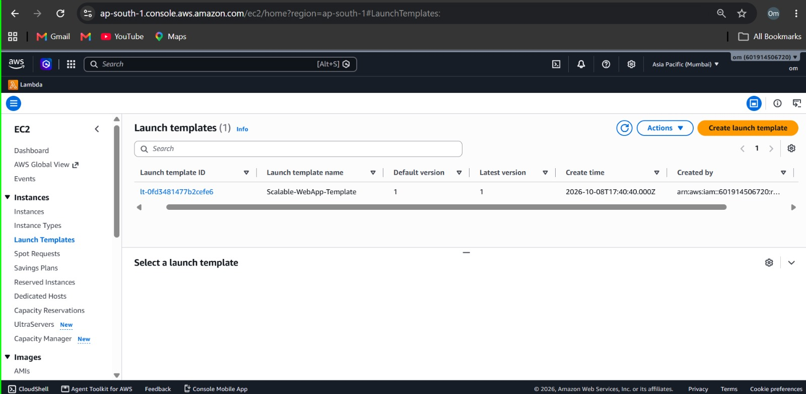
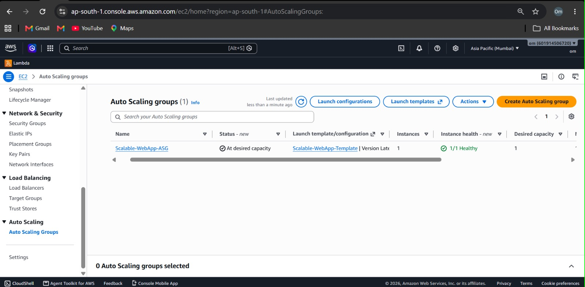
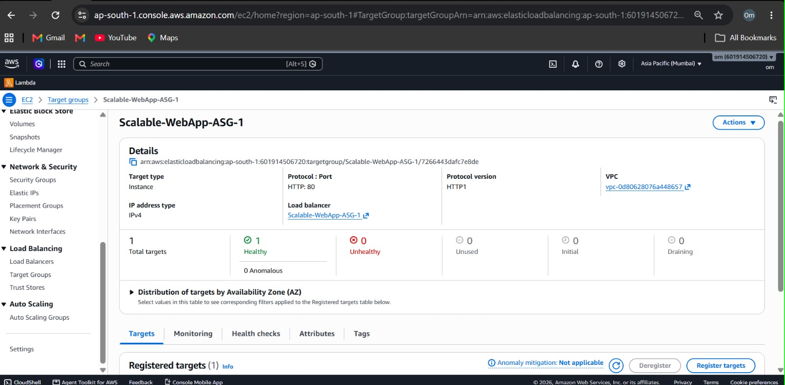
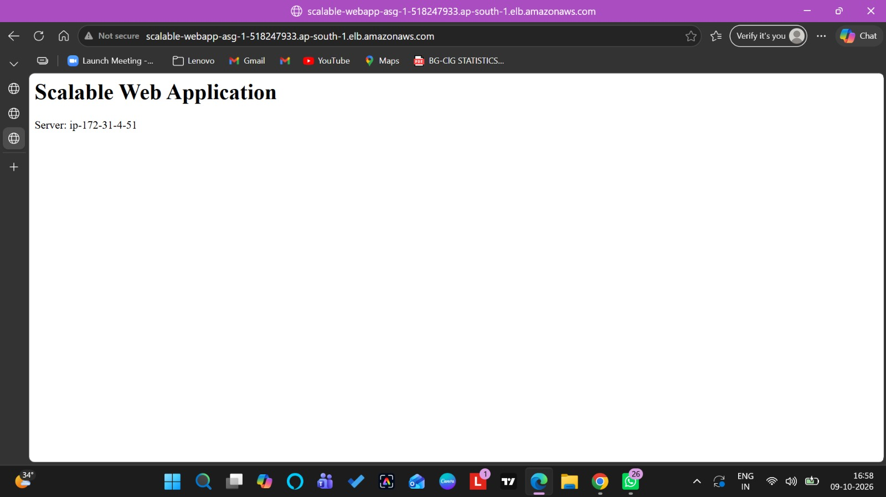

# Scalable Web Application Using ALB and Auto Scaling

## 1. Project Title and Objective

### Project Title
Scalable Web Application Using Application Load Balancer (ALB) and Auto Scaling

### Objective
To deploy a scalable web application on AWS that distributes incoming traffic across EC2 instances using an Application Load Balancer. The Auto Scaling Group manages EC2 instance capacity based on configured scaling policies, helping the application handle changing workloads.

## 2. AWS Services Used

- **Amazon EC2:** Runs the web application.
- **Amazon Machine Image (AMI):** Stores the configured instance image for launching new instances.
- **EC2 Launch Template:** Defines the configuration used to launch EC2 instances.
- **Auto Scaling Group:** Manages the number of EC2 instances.
- **Application Load Balancer (ALB):** Distributes incoming HTTP traffic across registered targets.
- **Target Group:** Registers EC2 instances and performs health checks.
- **Amazon CloudWatch:** Monitors CPU utilization.
- **Security Groups:** Control inbound and outbound network traffic.
- **AWS IAM:** Manages permissions required for AWS resources.

## 3. Architecture / Workflow

### Architecture Flow

Client Browser
      |
      v
Application Load Balancer (HTTP :80)
      |
      v
Target Group
      |
      v
EC2 Instances
      |
      v
Auto Scaling Group

Amazon CloudWatch monitors CPU utilization. A target tracking scaling policy is configured with a target CPU utilization of 50%.

### Workflow

1. A user accesses the application through the ALB DNS name.
2. The Application Load Balancer receives the HTTP request.
3. The ALB forwards the request to a healthy target.
4. An EC2 instance processes the request and displays the application page.
5. The Auto Scaling Group manages EC2 instance capacity.
6. CloudWatch provides CPU utilization metrics for monitoring and scaling.

## 4. Implementation Steps

1. Launched and configured an EC2 instance.
2. Deployed a basic web application displaying the server identity.
3. Created an AMI named `Scalable-WebApp-AMI`.
4. Created a Launch Template named `Scalable-WebApp-Template`.
5. Created the Auto Scaling Group named `Scalable-WebApp-ASG`.
6. Created an Application Load Balancer named `Scalable-WebApp-ASG-1`.
7. Created an HTTP Target Group on port 80.
8. Connected the Target Group with the Auto Scaling Group.
9. Configured health checks for the registered EC2 instances.
10. Configured a target tracking scaling policy with a 50% CPU utilization target.
11. Opened the application using the ALB DNS name.
12. Monitored CPU utilization through Amazon CloudWatch.

## Project Screenshots

### 1. AMI Available

### 2. Launch Template

### 3. Auto Scaling Group

### 4. Target Group Health

### 5. Website with Server ID

## 6. How to Run or Deploy the Project

1. Sign in to the AWS Management Console.
2. Select the Mumbai region (`ap-south-1`).
3. Ensure the AMI and Launch Template are available.
4. Configure the Auto Scaling Group with the required minimum, desired, and maximum capacities.
5. Ensure the Application Load Balancer is active and its HTTP listener forwards requests to the correct Target Group.
6. Verify that registered EC2 targets are Healthy.
7. Copy the ALB DNS name from the AWS Console.
8. Open the DNS name in a browser using HTTP.
9. Verify that the web application displays the server identity.
10. Monitor CPU utilization using CloudWatch.

**Note:** AWS resources must be configured in your own account. Resource IDs, networking settings, permissions, and costs may differ.

## 7. Key Learnings

- Learned how to launch and configure EC2 instances.
- Understood AMI creation and Launch Template configuration.
- Learned how to configure an Auto Scaling Group.
- Understood Application Load Balancer and Target Group integration.
- Learned how to verify target health checks.
- Practiced monitoring CPU utilization using CloudWatch.
- Understood CPU target tracking scaling policies.
- Learned how load balancing and Auto Scaling support scalable application architectures.

## Conclusion

The main AWS infrastructure was configured successfully. The web application was accessible through the Application Load Balancer DNS name, healthy targets were verified, and a CPU target tracking policy was enabled.

**Testing Status:** CPU-triggered automatic scale-out was not fully verified during this project. Therefore, automatic instance creation under high CPU load remains a pending test.
